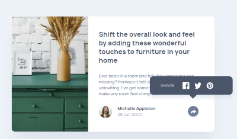

# Frontend Mentor - Article preview component solution

This is a solution to the [Article preview component challenge on Frontend Mentor](https://www.frontendmentor.io/challenges/article-preview-component-dYBN_pYFT). Frontend Mentor challenges help you improve your coding skills by building realistic projects. 

## Table of contents

- [Overview](#overview)
  - [The challenge](#the-challenge)
  - [Screenshot](#screenshot)
  - [Links](#links)
- [My process](#my-process)
  - [Built with](#built-with)
  - [What I learned](#what-i-learned)
  - [Continued development](#continued-development)
  - [Useful resources](#useful-resources)
- [Author](#author)
- [Acknowledgments](#acknowledgments)

## Overview

### The challenge

Users should be able to:

- View the optimal layout for the component depending on their device's screen size
- See the social media share links when they click the share icon

### Screenshot



### Links

- Solution URL: [View code](https://github.com/marefpceo/fem-article-preview-component)
- Live Site URL: [View live](https://marefpceo.github.io/fem-article-preview-compnonent)

## My process

### Built with

- Semantic HTML5 markup
- CSS custom properties
- Flexbox
- Mobile-first workflow
- Javascript

### What I learned

This challenge was a good refresher on using vanilla Javascript with a website. No new concepts were introduced, but I did make use of the `element.classList.toggle()` method. A method that I haven't used before. The method was used to toggle the visibility state of a share button and share toast. 

Using the method was quite easy. It required me to create a `.hidden` utility class with the display set to none. 

```css
.hidden {
  display: none;
}
```
Next I applied the class based on the initial visibility state. As shown below, the `toast`'s initial state is hidden, so the `.hidden` class is applied. If the initial state was to show the `toast`, then the `.hidden` class would simply be removed.
```html
<!-- Initial state hide toast -->
<div class='share-toast toast-shadow hidden' id='toast'>
  <!-- div contents -->
</div>

<!-- Initial state show toast -->
<div class='share-toast toast-shadow' id='toast'>
  <!-- div contents -->
</div>
```

With the class applied to the div, an event listener can be assigned to the share button so that every time the share button is clicked, the event will be fired. 

### Continued development


### Useful resources

- [MDN Web Docs](https://developer.mozilla.org/en-US/) - This site helps as a desk reference for topics that are not frequently used and to make sure best practices are followed.
- [Accessibility Developer Guide](https://www.accessibility-developer-guide.com/introduction/) - This site is a comprehensive resource guide to utilizing accessibility.

## Author

- Website - [Lamar S.](https://www.lamar-stevens.com)
- Frontend Mentor - [@marefpceo](https://www.frontendmentor.io/profile/marefpceo)
- Twitter - [@stevens14704](https://www.twitter.com/stevens14704)
